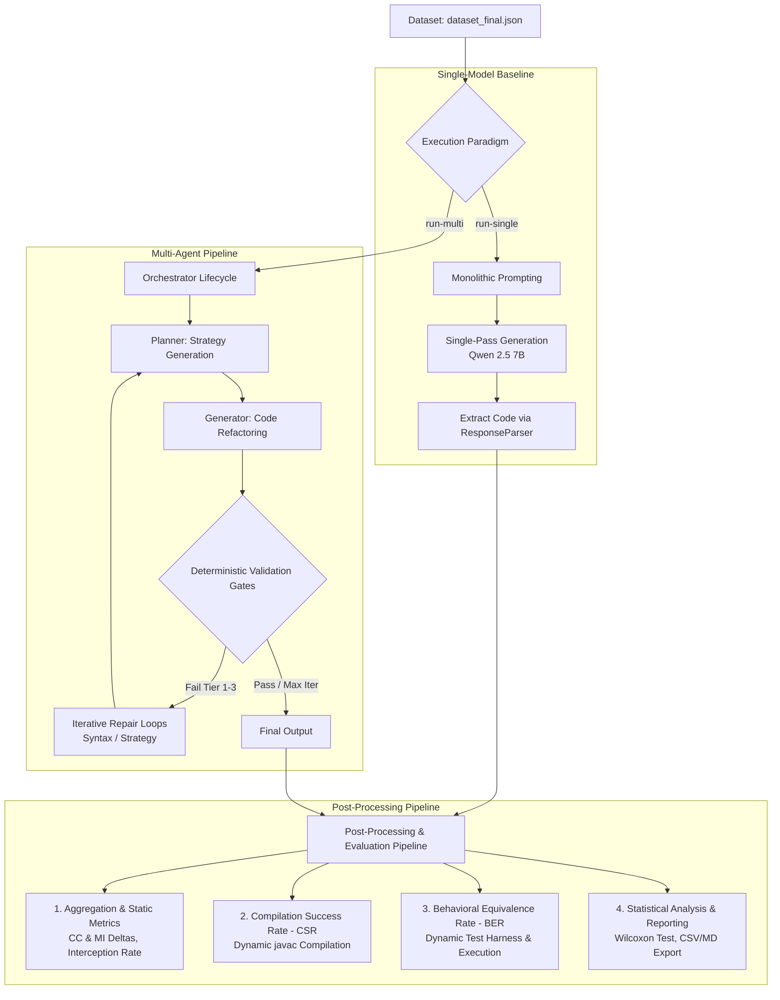

# Benchmark Process Documentation

This document details the complete benchmarking pipeline used to evaluate and compare the **Multi-Agent Code Refactoring Framework** against the **Single-Model Baseline**.

---

## 1. Overview of the Benchmarking Process

The benchmark evaluates how effectively LLM-based systems refactor source code (specifically Java codebase entries derived from algorithmic problem sets). It executes two evaluation tracks—**Single-Model Baseline** and **Multi-Agent Pipeline**—over a shared dataset ($n = 279$) and processes the generated code through automated static and dynamic validation gates.

---

## 2. Main Process Workflow

### Phase 1: Task Feeding & Execution

The benchmark runner feeds each dataset task (`num`, `source_code`, `instruction`, `difficulty`, `intent`) into the selected evaluation runner.

#### Track A: Single-Model Baseline (`run-single`)
1. **Model Loading**: Loads monolithic 7B model (`Qwen2.5-Coder-7B-Instruct.gguf`).
2. **Single-Pass Prompting**: Feeds `source_code` and `instruction` in a single system/user prompt pass ($\text{temp} = 0.1$, $\text{max\_tokens} = 4096$).
3. **Response Extraction**: Uses `ResponseParser` to extract refactored Java code wrapped inside `<code>` XML tags.
4. **Metric Capture**: Logs single-pass duration, GPU VRAM utilization via `PerformanceTracker`, and raw code changes.

#### Track B: Multi-Agent Pipeline (`run-multi`)
1. **Role Decomposition**: Distributes tasks across specialized 3B model roles (Planner, Generator, Judge: `Qwen2.5-Coder-3B` & `Llama-3.2-3B`).
2. **Orchestrated Multi-Phase Execution**:
   - **Phase 1 (Planning)**: Planner formulates a structured refactoring strategy.
   - **Phase 2 (Generation)**: Generator executes code transformation based on strategy.
   - **Phase 3 & 4 (Validation Gates)**: Deterministic validation pipeline intercepts errors across tiers:
     - *Tier 1*: Syntax validation (`javac` check).
     - *Tier 2*: Algorithmic quality (Cyclomatic Complexity, Boundary cases, Math/Intent integrity).
     - *Tier 3*: LLM Judge evaluation.
3. **Iterative Feedback Loops**: If code fails validation, feedback is fed back into iterative repair loops (Syntax heal loop & Strategy retry loop) until resolution or abort.
4. **Metric Capture**: Tracks step-by-step timing (`gen_timings`), iteration counts (`strategy_iter`, `syntax_iter`), peak/avg GPU VRAM usage, and cumulative tier findings.

---

### Phase 2: Post-Processing & Evaluation

Once execution completes, raw output JSON files undergo systematic offline post-processing using a combination of **custom Python/Node.js scripts** and **specialized analytical libraries**:

#### Custom Scripts Used:
- `backend/benchmark/analysis/aggregate.py`: Custom offline aggregation script that summarizes pass rates, Cyclomatic Complexity ($\Delta CC$) deltas, Maintainability Index ($\Delta MI$) deltas, and Tier 1–3 validation interception rates across strategy iterations.
- `backend/benchmark/analysis/csr.py`: Custom compilation testing script that wraps generated code methods and compiles them dynamically via subprocess calls.
- `backend/benchmark/analysis/ber.py`: Custom behavioral equivalence testing script that dynamically constructs reflection-based Java test runners (`_BW_` main class) and runs unit tests.
- `backend/app/utils/halstead.py`: Custom Halstead metric calculator that parses Java AST nodes to measure distinct/total operators ($n_1, N_1$), operands ($n_2, N_2$), Halstead Volume ($V$), and Maintainability Index ($MI$).
- `backend/benchmark/analysis/report.py`: Custom report generator that exports per-entry benchmark metrics into structured CSV and JSON reports.
- `backend/benchmark/generate_report.js`: Custom Node.js report rendering script that generates HTML/Markdown evaluation summaries and embeds visual figures.
- `backend/benchmark/results/v3/notebooks/resolution_rate.ipynb`: Custom Jupyter notebooks for statistical analysis and visualization.

#### Analytical Libraries Used:
- **`javalang`**: Java AST parsing library used for inspecting Java source code structure, extracting method signatures, and walking AST nodes (`BinaryOperation`, `IfStatement`, `MethodInvocation`, `MemberReference`, etc.) to count Halstead operators and operands.
- **`lizard`**: Code complexity analyzer used for computing McCabe Cyclomatic Complexity ($CC$) across method decision paths.
- **`scipy` (`scipy.stats`)**: Scientific computing library used for statistical significance testing (Shapiro-Wilk test for normality, Wilcoxon Signed-Rank test for paired duration differences).
- **`pandas` & `numpy`**: Data manipulation libraries used for tabular data structuring, metric aggregation, and numerical computations.
- **`matplotlib` & `seaborn`**: Plotting libraries used for rendering distribution charts, density plots, and performance comparison figures.
- **Python Standard Library (`subprocess`, `tempfile`, `json`, `re`, `math`)**: Process management for executing OpenJDK `javac`/`java` commands, creating isolated temporary `.java` source files, performing regex pattern normalization, and math operations.

#### Pipeline Steps:

1. **Aggregation & Static Analysis (`python -m benchmark aggregate`)**
   - **Cyclomatic Complexity (CC)**: Computes $CC$ deltas ($\Delta CC = CC_{refactored} - CC_{original}$) using AST-based branch counting via `lizard`.
   - **Maintainability Index (MI)**: Calculates composite MI using `halstead.py` based on Halstead Volume ($V$), Cyclomatic Complexity ($CC$), and Lines of Code ($LOC$).
   - **System Resolution & Interception Rates**: Measures the percentage of tasks resolved and tier interception volume across iterative repair loops.

2. **Compilation Success Rate - CSR (`python -m benchmark csr`)**
   - Wraps extracted Java methods into compilable wrapper classes via `wrap_code()`.
   - Dynamically compiles code against runtime-compiled stub classpath (`stubs_classpath`) using OpenJDK `javac --release 21` spawned via Python `subprocess`.
   - Measures raw syntactical viability across all dataset entries.

3. **Behavioral Equivalence Rate - BER (`python -m benchmark ber`)**
   - **Funnel Evaluation**: Applied strictly to syntactically valid (compiled) outputs to prevent survivorship bias.
   - **Dynamic Test Harness Generation**: Generates reflection-based Java test runners (`_BW_` class, `_make_test_wrapper`) mapping dataset test inputs to Java method parameters.
   - **Runtime Execution**: Compiles test harness with `javac` and executes the `java` process under strict time bounds (10–15s caps).
   - **Functional Verification**: Compares normalized output string representations against expected public and private test case outputs.

4. **Statistical Analysis & Report Generation (`report.py` / Notebooks)**
   - **Normality Testing**: Applies Shapiro-Wilk Test ($W$) via `scipy.stats.shapiro` on execution duration and metric deltas.
   - **Hypothesis Testing**: Conducts non-parametric Wilcoxon Signed-Rank Tests via `scipy.stats.wilcoxon` to evaluate statistical significance ($p < 0.001$).
   - **Report Export**: Compiles findings into Markdown reports (`Horizon-Benchmark-Report.md`), CSV files, and visual charts.

---

## 3. Technology Stack

The benchmarking framework is built on a modular stack combining Python orchestration, local LLM inference engines, Java compilation tooling, and data science libraries:

| Layer | Technology | Purpose / Usage |
| :--- | :--- | :--- |
| **Core Language & Runtime** | Python 3.10+ | Asynchronous benchmark execution (`asyncio`), process control (`subprocess`), CLI (`argparse`). |
| **LLM Inference Engine** | llama.cpp / llama-cpp-python | High-performance GGUF local model execution on GPU/CPU. |
| **Evaluated Models** | Qwen 2.5 Coder 7B, Qwen 2.5 Coder 3B, Llama 3.2 3B | Monolithic baseline and multi-agent specialized roles (Planner, Generator, Judge). |
| **Java Compiler & Runtime** | OpenJDK 21 / 25 (`javac`, `java`) | Dynamic bytecode compilation, stub generation, reflection execution for test suites. |
| **AST & Code Parsing** | `javalang` | Java source parsing and method parameter/signature extraction. |
| **Static Code Metrics** | `lizard`, Custom Halstead / MI Modules | Cyclomatic Complexity ($CC$) calculation and Maintainability Index ($MI$) scoring. |
| **Hardware & Perf Tracking** | Custom `PerformanceTracker` | VRAM peak/average memory tracking & GPU utilization monitoring. |
| **Data Science & Statistics** | `pandas`, `numpy`, `scipy` | Data aggregation, Shapiro-Wilk normality testing, and Wilcoxon Signed-Rank tests. |
| **Visualization & Reporting** | `matplotlib`, `seaborn`, Node.js | Plotting distribution graphs/density plots and rendering HTML/Markdown benchmark reports. |
